# Context Guru: carry less, pay less

Your AI agent carries a bag of context, and you pay for the whole bag on every request. It works that way in Claude Code, Codex, Bob or an agent you wrote yourself. When the provider's cache goes cold, the same bag costs 25 times more to carry.

Picture an ordinary afternoon. An agent is fixing a bug, and its session has grown to 800,000 tokens (a token is a word or part of a word, and it is what you are billed for). It hands the change to a reviewer, a second agent started for that one job, which takes 20 minutes. Then it runs a test suite that takes 10.

The provider keeps the part of every request that repeats (instructions, tools and the whole conversation so far) in a cache, but only for five minutes after it was last used. If the reviewer had answered at minute four, the next request would have read that cache for **$0.16** on Claude Opus 5.5. It took half an hour, the cache had expired, and the agent paid **$4.00** to build it again.

| List price per million tokens | Fresh input | Cache write (5 min) | Cache write (1 hour) | Cache read | Output |
|---|---|---|---|---|---|
| Claude Opus 5.5 | $4.00 | $5.00 | $8.00 | $0.20 | $20.00 |
| Claude Sonnet 5.5 | $2.00 | $2.50 | $4.00 | $0.10 | $10.00 |

Writing the five-minute cache costs 25 times as much as reading it, on both models. Most of this post follows from that one ratio.

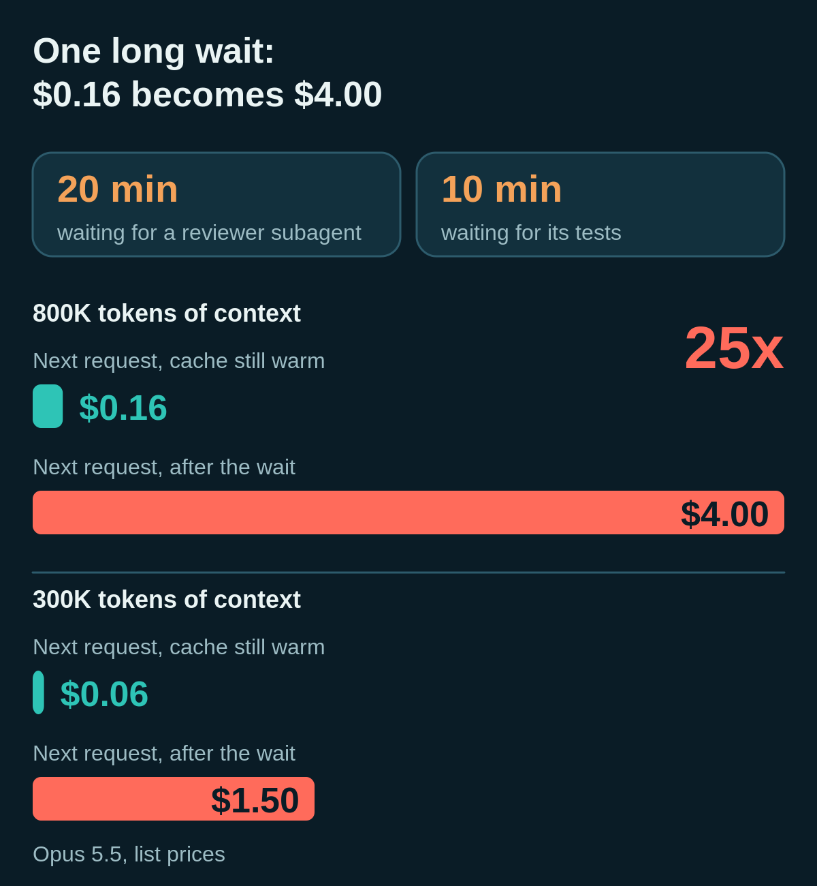

!!! important "What Context Guru is"

    Context Guru is a library that watches your agent's traffic between your harness and the model provider. We provide plugins for all major harnesses. You can install it with a built-in local proxy, so your data stays on your machine, or use a shared proxy.

!!! important "Our north star: the models you run yourself"

    Everything in this post is about the APIs of the frontier labs and their pricing, where the provider sets the rules and we work around them. When you run the model yourself, on vLLM or [llm-d](https://llm-d.ai), you can set the rules: what stays in the cache, for how long, and when to compact. Then the saving is GPUs you do not need to buy. We expect that opportunity to be bigger than what you see here, though we have not measured it yet. Stay tuned. Spring is coming.

**How much will you save?** It depends on how you work. On our own teams, the product's dashboard shows **$183.80 saved in the last 24 hours, 20% of what the work would have cost**.

<!-- more -->

## Short on time? Watch this

A two-and-a-half-minute video: the bag, the four things Context Guru does, our team's dashboard and our best session.

<video src="../../../../../assets/context-guru/cg-overview-720p.mp4" controls playsinline preload="metadata" poster="../../../../../assets/context-guru/poster_overview.png" width="100%"></video>

## What Context Guru does

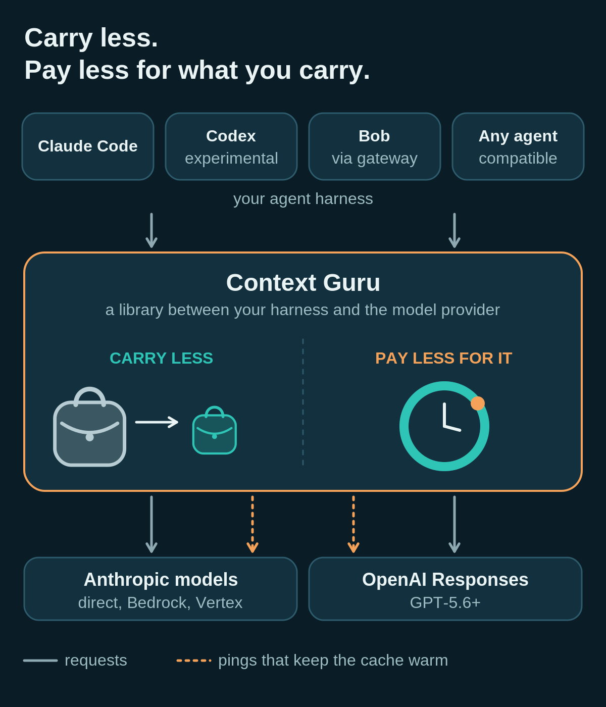

Context Guru does four things. Three make the bag smaller, and one makes what is left cheaper to carry. You choose how much it trims with a **preset**. The default, `off`, trims nothing and only manages the cache. The others are `conservative`, `medium`, `high` and `xhigh`, the deepest.

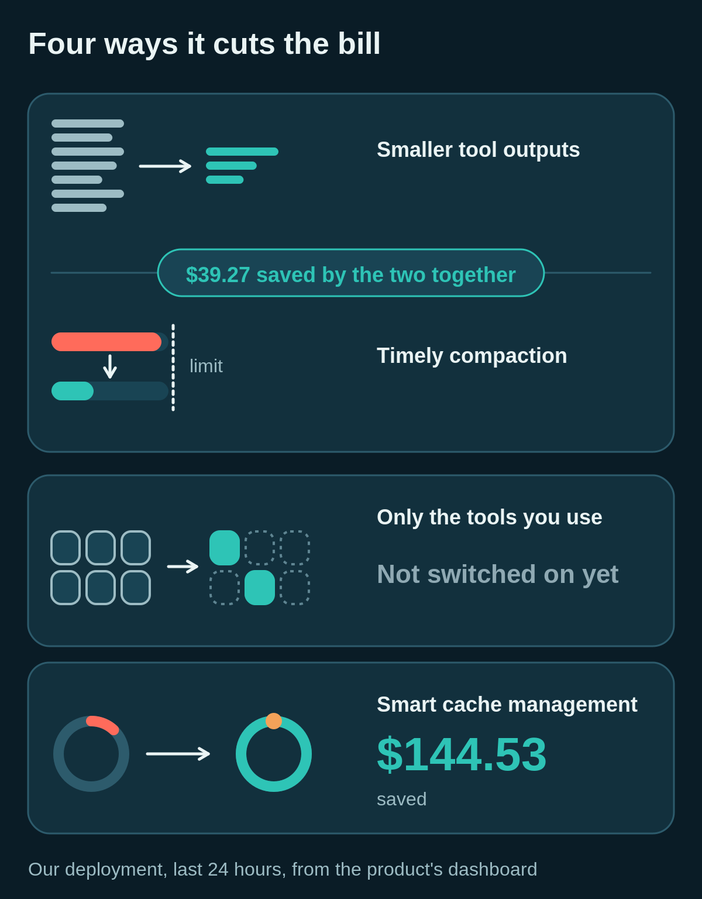

**Smaller tool outputs.** Test logs, search results and shell output are full of clutter, like colour codes, the same file path over and over, and repeated lines. Context Guru strips it out before the agent sends that output back to the model on its next request.

**Tools and skills you never use.** Every request lists every tool the agent could call, whether it uses it or not. That includes MCP tools (plug-ins that connect outside services) and skills (saved instructions for particular jobs). Context Guru can leave out the ones the agent never touches.

**Compaction at the right moment.** Compaction shrinks a long conversation by cutting what the agent no longer needs. Context Guru prepares the cut while the cache is still warm, then applies it on the first request after the cache goes cold, since the whole prompt has to be written again at that point anyway. The cut adds no cost, and every later turn (one round of the agent asking and the model answering) is smaller. Its gentlest cut, the **sweep**, asks a model during a ping, while the cache is cheap to read, which old tool output the agent no longer needs. It removes that output and leaves a marker, so the agent can fetch the text back.

**Smart cache management.** While you are away, or while the agent waits for a long test run or for another agent, Context Guru decides whether the cache is worth keeping warm. If it is, it sends a **ping**: a tiny request that reads the cache and restarts its five-minute clock. One ping costs a twenty-fifth of a rewrite.

Pings work on Anthropic models (direct, Bedrock and Vertex), and on recent OpenAI models through the Responses API, where the cache lasts longer.

## One real session

In the 90-second video below, we recorded a Claude Code session from install to dashboard. Watch the **band**, the status line above the prompt. It shows what your next message will cost with a warm cache and with a cold one, what you have saved so far, and how long the cache has left.

<video src="../../../../../assets/context-guru/cg-session-720p.mp4" controls playsinline preload="metadata" poster="../../../../../assets/context-guru/poster_session.png" width="100%"></video>

We stepped away for 12 minutes on purpose. Pings kept the cache warm, so the next message cost $0.04 instead of $1.09.

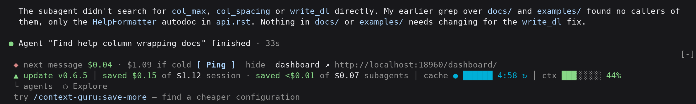

## What it did for our teams

Our IBM Research teams use Context Guru every day on Claude Code. Over the week this post covers, 20 accounts sent traffic and about 10 to 16 were active on a working day. This is the product's own dashboard on our deployment for the last 24 hours (November 4, 11:54 to November 5, 11:54 UTC):

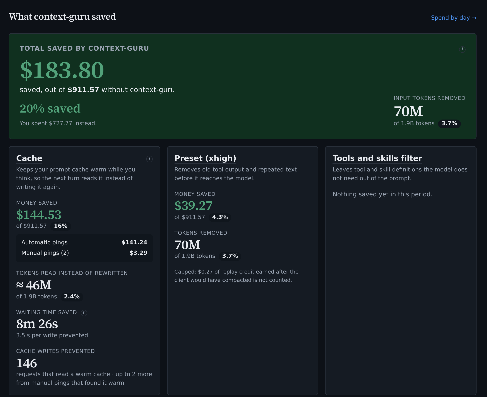

Without Context Guru that day would have cost **$911.57**. Our teams spent **$727.77**, pings included. Most of the saving, **$144.53**, came from keeping caches warm while people were away. On 146 requests, the cache was read instead of written again. Another **$39.27** came from trimming old tool output and compacting.

Every developer saved something, from 10% to 36%:

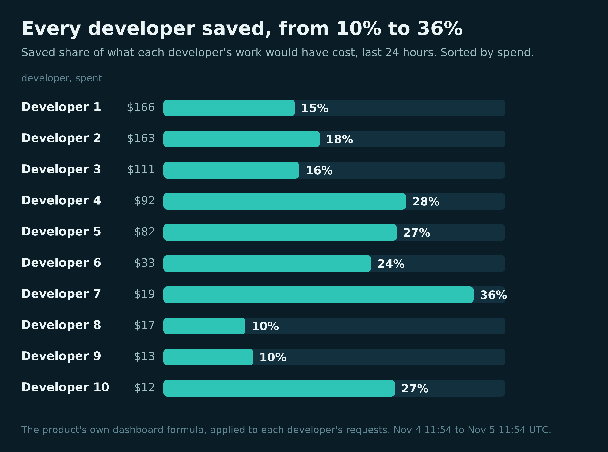

Our teams chose `xhigh`, the deepest preset; yours starts at `off`. The tools-and-skills filter was off, so it saved nothing.

### A normal session

Our best session saved a third. A normal one saves about an eighth. Here is one: an Opus session that ran most of a working day and grew to 457,000 tokens.

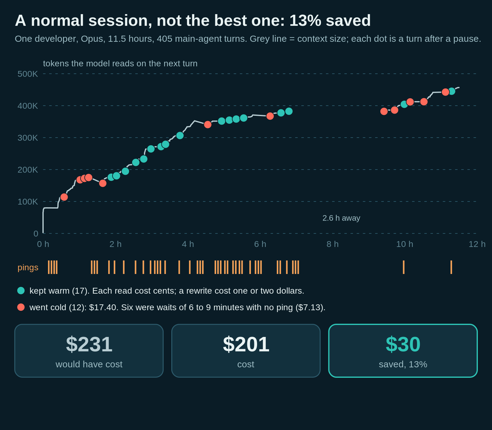

Context Guru kept the cache warm through 17 pauses, and each time the next turn read it for a few cents instead of rewriting it for one or two dollars. Twelve pauses still went cold and cost $17.40. Six of those were waits of six to nine minutes that got no ping, just past the cache's five-minute life. The session cost $201 instead of $231.

### The best session

This session ran on Opus 5.5, on and off over five days, and grew to 839,000 tokens. Without Context Guru it would have cost **$205**. It cost **$137**, so **$68 saved, a third**.

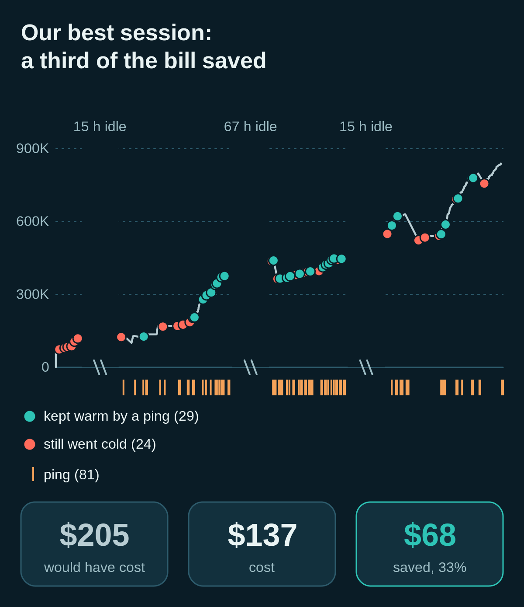

The session had 59 long pauses. Here is what happened in them:

| What happened | How often | Cost or saving |
|---|---|---|
| Context Guru sent pings (81 in all) | in 48 of the 59 pauses | cost $11 |
| The pings kept the cache warm when the agent came back | 29 pauses | avoided $62 of rewrites; reading the same caches warm cost $2.47 |
| Trimming old tool output | the whole session | saved another $19 |
| The cache still went cold | 24 pauses | cost $38, the next thing we want to fix |

### Not every session wins

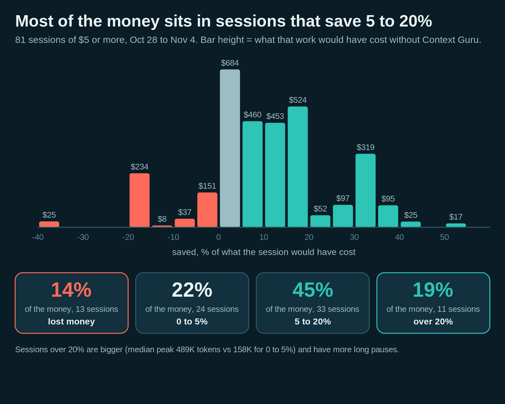

We looked at the 81 sessions that cost at least $5, which hold almost all the money. Eleven saved more than a fifth, 33 saved between 5% and 20%, and 24 saved up to 5%. Thirteen lost money, $54 in all. The winners are long sessions with one agent and plenty of breaks. The losers are swarms of short-lived subagents that finish before any pause begins, so any pings sent their way buy nothing.

### Our deployment is also our lab

Because we run the deployment ourselves, we can change the ping strategy from one day to the next and see what each one is worth in dollars.

One thing we learned is that how long an agent waits depends on *why* it stopped. An agent waiting for its own test run is back in minutes, while a person who went to a meeting may not be back today. So we now set the number of pings by what the agent is waiting for: up to eight for its own tool, five for background work, three for a person. A first replay said this would save 16% more. When we replayed the code we actually shipped, it did no better than the plan it replaced and sent three times as many pings, so we now replay the real code before we ship it.

## Subagents keep caches small, pings keep them warm

This comes from two of our own sessions on a laptop and from the hosted deployment used by people in our department. We also wrote about it [on LinkedIn](https://www.linkedin.com/posts/davidamid_aiagents-claudecode-contextengineering-share-7523106838612094976-x4Ic/).

The **main agent** is the one you talk to. It plans and decides, and it starts subagents, helper agents that each take on one task. Its context is large: about 860 messages and 180,000 tokens in these two sessions. A subagent does one task. Almost everything it does is run commands (854 of 856 calls in one session): it builds, tests, and opens or fixes a pull request. Its context is smaller, about 300 messages and 95,000 tokens, mostly tool output. Its long pauses come from its own commands, a test run or a remote build. It seldom waits for the main agent.

Because each subagent's context is small and focused, its cache is cheap to keep warm. Context Guru does that while the subagent waits for its command, sending a ping at about four minutes. The ping reads the cache for one to three cents and saves a rewrite that would cost 20 to 70 cents when the result comes back. In one session, $2.76 of pings saved the subagents **$15.39**.

**Where it still cost us money.** Three things got in the way. We changed two of them in the newest version, and an earlier fix took care of the third.

- *Small subagents were never pinged.* Context Guru skipped pings for any cache under 80,000 tokens, on the theory that small caches are cheap to rewrite. But subagents are small by design, so their caches went cold. The rule blocked the ping in 47 of the 51 subagent pauses that went cold unpinged. The limit is now 20,000 tokens. Side calls, the small background requests an agent makes without using any tool are no longer pinged at all.
- *Two pings were too few for the long waits.* When the main agent waited for background work or for a person, two pings ran out too early. Extra pings paid off on our laptop, which led to the wait-aware plan above.
- *A finished subagent looked like it was still working.* A subagent hands in its final answer through a special tool call, and Context Guru read that as "waiting for a tool". On the hosted deployment, 226 finished subagents were pinged for nothing. That is fixed ([#857](https://github.com/rossoctl/context-guru/issues/857), [#859](https://github.com/rossoctl/context-guru/pull/859)).

Across the whole deployment, subagent pings lost money in late October, mostly on those finished subagents. Since the fixes they cost about three cents each and roughly break even. One idea did not work out. For subagents, the one-hour cache (the pricier write option in the table) costs more than pings and leaves the sweep almost nothing to do.

## Where the rest of the money goes

After all of that, where does the remaining bill go? We split every dollar our teams spent from October 28 to November 3, $2,225 in all.

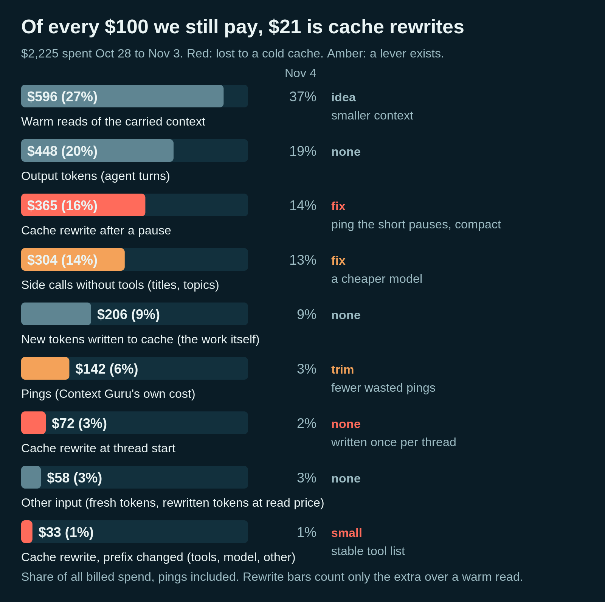

The biggest slice, 27%, is reading the context that is already cached. That is the cost of carrying a big bag, and only a smaller bag shrinks it. Output, the model's own answers, is another 20%, and we leave it alone.

The slice we care about most is **cache rewrites after a pause: $365, 16% of the bill**. Add the rewrites when a new agent starts its conversation and after a changed prompt, and cold caches take $470 of the $2,225, about one dollar in five. (The middle column in the figure is the same split for November 4 alone.) Rewrites for any reason other than time, such as a changed tool list or a switched model, were only 1%. Waiting is what empties the cache.

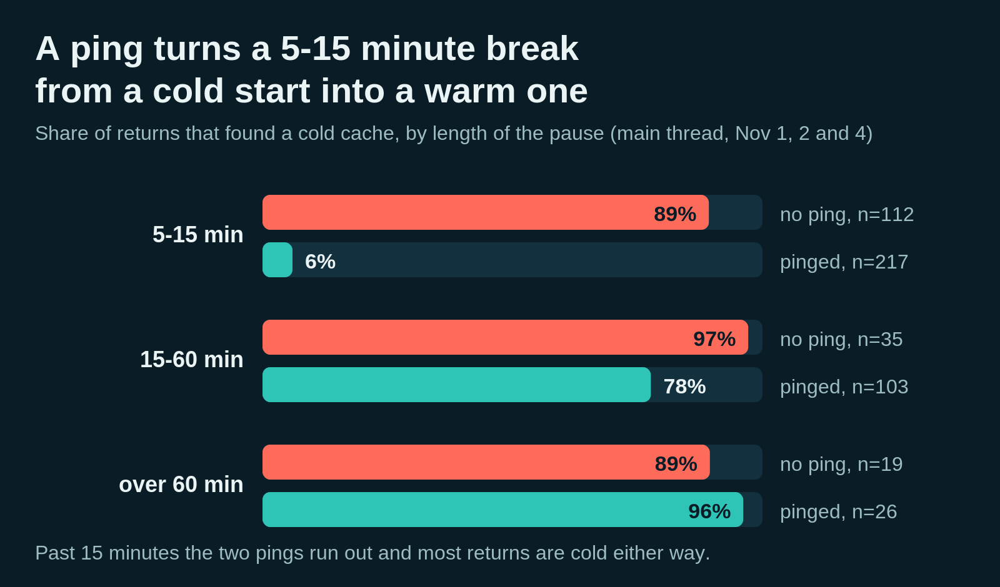

Pings help on short breaks. After a break of 5 to 15 minutes, 6% of pinged returns (the first request after the break) found a cold cache, against 89% when no ping was sent. This was not a controlled test, but the gap holds for small, medium and large contexts alike (329 such breaks on November 1, 2 and 4). Past fifteen minutes, most returns are cold either way.

The bigger the context, the more a cold return hurts.

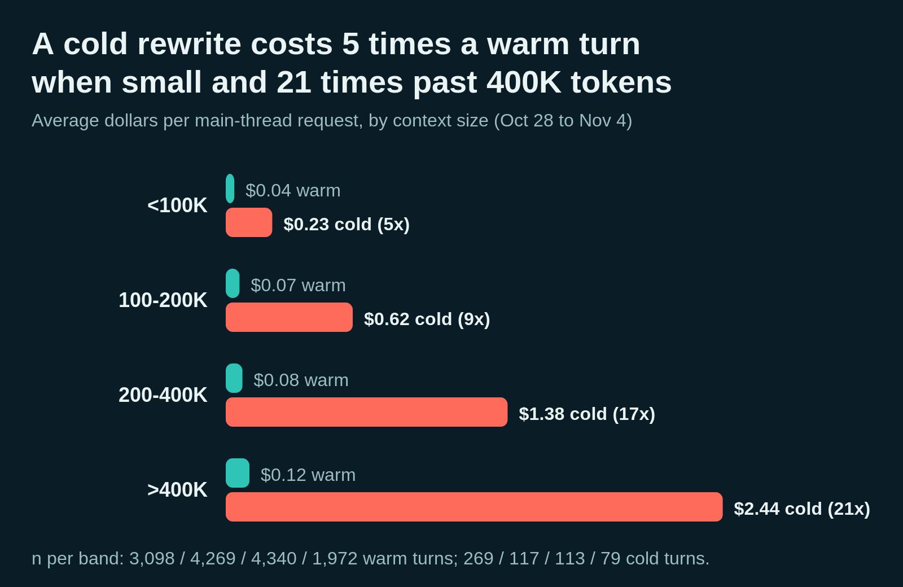

A normal turn costs us about seven cents. Past 400,000 tokens, one cold return is $2.44, the price of twenty warm turns.

## Does it hurt accuracy?

Cache management never changes what the model reads. A ping is a separate request, and the agent's own requests pass through untouched. We checked 93 requests, and all 93 came out byte for byte the same.

The other three trim and compact, so they do change what the model sees. We tested the conservative preset on coding tasks and saw no loss. In 32 of 32 runs with long pauses the answer was correct, 48 of 48 short bug fixes were solved (as they are without Context Guru), and 18 of 18 long sessions that we stopped and resumed ended with the full test suite green. The samples are small, so read this as no sign of harm rather than proof.

We have not run the same tests on the deeper presets that our own teams opted in to. So trimming is opt-in. The dashboard shows every edit Context Guru made, request by request, and `/context-guru:save-more` shows you what a setting would have done on your own sessions before you turn it on.

## What surprised us

Two things we did not expect, from our own deployment (October 28 to November 4, priced at list).

**1. A 95% cache-hit rate can hide a big bill.** Think of a café that sells 95 coffees and 5 steaks: the steaks are where the money is. On our deployment, 95% of prompt tokens were read from the cache. Yet one dollar in five went to rewriting a cold cache, and for the biggest sessions it was nearly half. A token that misses the cache costs 25 times one that hits, so the 5% of prompt tokens that miss the cache set the bill. Track the dollars spent on rewrites instead of the hit rate. The band and the heatmap below both do.

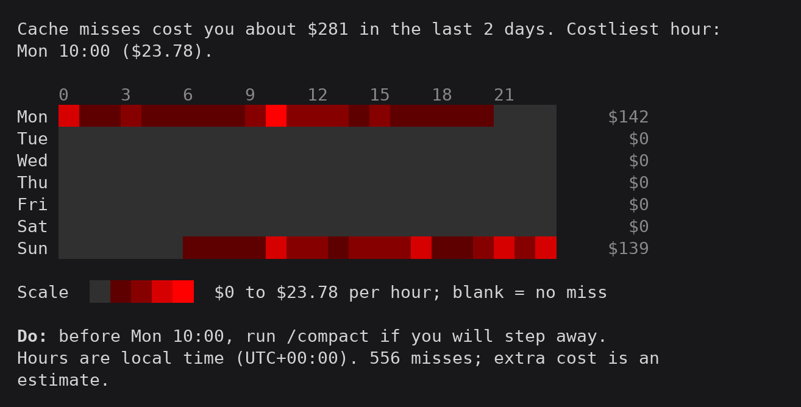

**2. When you cut matters more than what you cut.** Across the deployment, simple rules that trim tool output as it arrives saved $8 over six days. The sweep, which cuts when the cache has gone cold and the rewrite is paid for anyway, saved $64. (The $19 in the best session came from the deep preset's cuts, a third kind.) Get the timing right first.

## What we're working on now

!!! important "First: cache control for the models you run yourself"

    vLLM and llm-d already reuse cached prefixes and route requests to where the cache lives. What we did not find is a way for the agent's side to say how long a cache should live, or to compact on the server. We want to help add both.

**Cortex as our proxy, and a much bigger experiment.** [Cortex](https://github.com/rossoctl/cortex) is an open-source proxy for coding agents, built in the same organisation as Context Guru. You install one program on your laptop, point your agent at it, and watch every model call, tool call and dollar the agent spends, live. It already connects to Claude Code, OpenCode, Codex, IBM Bob and Pi, and to any agent that can use an HTTPS proxy. Your traffic stays on your machine: Cortex decrypts it with a certificate made locally, passes it through a chain of plugins, and sends it on to the server your agent asked for.

That plugin chain is where Context Guru fits. Cortex already ships an opt-in Context Guru plugin that trims an agent's requests before they leave the machine, and we are building the rest of Context Guru into it ([#619](https://github.com/rossoctl/context-guru/issues/619)). The two divide the work well. Cortex handles the connection to each harness and shows people what they spend. Context Guru decides what to carry and when to keep the cache warm. The same Cortex binary also runs as a sidecar on Kubernetes, so the setup that runs on a laptop can run for a whole team.

With Cortex as the front door, we want to take the experiment in this post from our own teams to a much larger group across IBM Research and Red Hat. More people and more kinds of work will show which of these savings hold up, which strategies to change, and where the next dollar is.

**More agent harnesses.** Most of what you read here was measured on Claude Code. We are now adding integrations for more harnesses. [OpenCode](https://opencode.ai) is an open-source agent that is common at Red Hat. IBM Bob is IBM's own coding agent, where every saving goes straight back to IBM's bill. The cache rules differ from one harness to the next, so each integration brings its own lessons, and we will report them as we go.

**A like-for-like comparison of context tools.** [RTK](https://github.com/rtk-ai/rtk), [Headroom](https://github.com/headroomlabs-ai/headroom), [caveman](https://github.com/JuliusBrussee/caveman), Context Guru and others each report savings on their own workloads, and we found no like-for-like comparison. We are building a library that runs them all on the same recorded sessions and tasks and measures what each feature is worth, in dollars and in accuracy.

**A cache-aware router for reasoning effort.** Reasoning effort is how long the model thinks before it answers. Thinking harder costs output tokens, and many turns do not need it. Some current models now let you change effort mid-conversation without losing the cache. On the Claude API this is a beta setting on specific models, including Opus 5.5 and Sonnet 5.5, and OpenAI documents a similar path. Changed the usual way, effort starts the cache over. We are building a router that lowers effort when it can, only through the cache-safe path, with as little effect on accuracy as possible.

## Try it

In Claude Code:

```text
/plugin marketplace add rossoctl/context-guru
/plugin install context-guru@context-guru
/reload-plugins
/context-guru:install
```

Other setups, including Codex and your organisation's hosted instance, are in the [install guide](https://github.com/rossoctl/context-guru#install). Work as usual for a few days, then run `/context-guru:insights` to see what happened. Not sure which setting to pick? `/context-guru:save-more` replays your own sessions before you change anything.

If your sessions look different from ours, we want to know how. Open an issue, and if Context Guru saved you money, [star the repo](https://github.com/rossoctl/context-guru).
