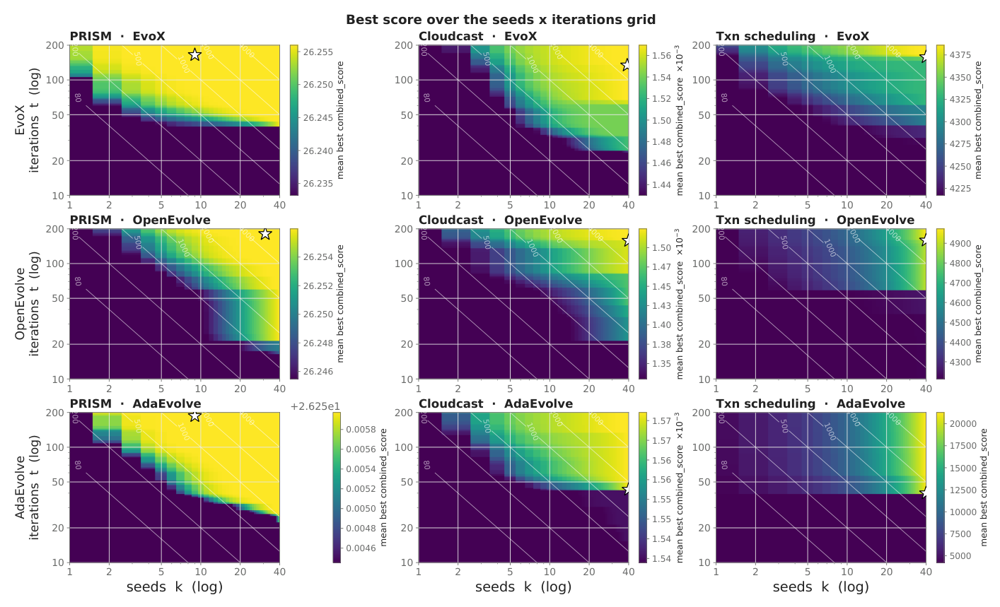
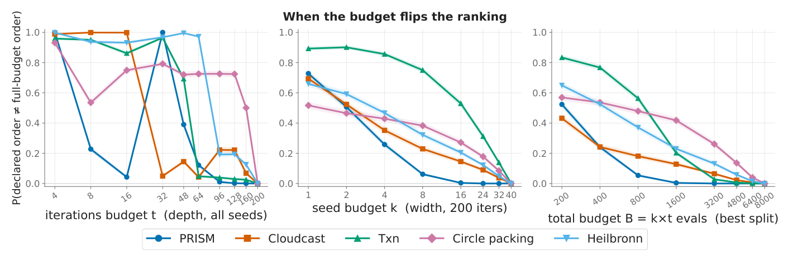

# The Winner Depends on the Budget: Evaluating LLM Evolutionary Search

LLM evolutionary search is a way to get better programs out of a language model over many attempts. The model writes a candidate program, an evaluator scores it, and the best programs so far go back to the model to be improved. AlphaEvolve and OpenEvolve work this way, and the strategies we compare differ in how they choose which programs to send back. Papers usually compare such strategies with one experiment per strategy and report which one scored highest. In this blog we show why that can mislead: the same strategies on the same tasks rank differently depending on how much compute they get and how it is divided. We end with recommendations for running and reporting these comparisons so the results hold up.

On Heilbronn, a geometry task, AdaEvolve is the best of the three evolutionary search strategies we tested when each gets a single seed, meaning one independent run of the search, of 200 iterations. Give every strategy forty seeds and EvoX comes out first. The model, the evaluator and the task stay the same; only the budget changes. We count the budget in proposals, the candidate programs the model writes and the evaluator scores. Each iteration of a seed is one proposal, so one seed of 200 iterations costs 200 proposals and forty seeds cost 8,000.

Most papers on LLM evolutionary search report one budget point, usually one seed (sometimes up to three) run for a fixed number of iterations, and rank methods from that result. In our paper, [Evolution or Illusion? Rethinking Evaluation in LLM Evolutionary Search](https://arxiv.org/abs/2609.19799), we measured what that one point leaves out.

<!-- more -->

## Width and depth

In LLM evolutionary search, a model proposes a program, an evaluator scores it, and the best programs go back to the model to be edited. Each seed runs this loop independently of the others, and the reported result is the best program across seeds. Width is the number of seeds (k), and depth is the number of iterations each seed runs (t). A budget of B = k × t proposals can be split in many ways: 800 proposals buy 4 seeds of 200 iterations, or 20 seeds of 40.

We ran OpenEvolve, EvoX and AdaEvolve for 40 seeds of 200 iterations each, on three systems tasks from ADRS-Bench, a benchmark suite for AI-Driven Research for Systems (PRISM, an LLM-serving scheduler; Cloudcast, a broadcast planner; and transaction scheduling) and two math tasks (circle packing and Heilbronn). The main runs use gpt-5-mini through the same engine, so only the strategy varies. These runs give us a grid of every split from 1 to 40 seeds and 1 to 200 iterations. To score a split (k, t), we take subsets of k of the 40 logged seeds, cut each one at iteration t, and compute the expected best score with exact order statistics. No additional runs are needed.

<figure markdown="span">
  { width="100%" }
  <figcaption>Expected best score over the grid of seeds (k) by iterations (t), one panel per strategy (rows) and systems task (columns). Each white diagonal connects splits with the same budget k × t, and the star marks the best split. From Figure 2 of the paper.</figcaption>
</figure>

## The best split moves

The full budget is 8,000 proposals (40 seeds × 200 iterations). The table shows the best split, written as (k seeds, t iterations), at the full budget and at about 10% of it, roughly 800 proposals.

| Task | Strategy | Full budget | ~10% budget |
|---|---|---|---|
| Cloudcast | EvoX | (40, 67) | (12, 67) |
| Cloudcast | OpenEvolve | (40, 158) | (5, 162) |
| Cloudcast | AdaEvolve | (40, 43) | (5, 158) |
| Transaction scheduling | EvoX | (40, 158) | (4, 198) |
| Transaction scheduling | OpenEvolve | (40, 159) | (13, 60) |
| Transaction scheduling | AdaEvolve | (38, 40) | (19, 40) |

At the full budget, the best splits in the table use all or nearly all 40 seeds, but the best depth ranges from 40 iterations (AdaEvolve on transaction scheduling) to 159 (OpenEvolve on the same task). Past that depth the expected best score flattens rather than falls, so extra iterations add little and proposals are better spent on more seeds. The best split can therefore use less than the full budget, since we search over every split with k × t of at most 8,000.

A flat top also means the reported split is not always the only good one. On Cloudcast with EvoX the top of the surface is a ridge and not a peak: at 40 seeds, every depth from 67 up to 200 scores about the same. We report the shallowest split on that ridge. Where the surface has a single clear peak, as Cloudcast with AdaEvolve does at 43 iterations, the table and the figure agree exactly.

At 10% of the budget the best splits spread further apart. EvoX on transaction scheduling does best with 4 seeds of 198 iterations, close to the full 200. AdaEvolve on the same task does best with the opposite shape: 19 seeds, each stopped after 40 iterations, because its score peaks around iteration 40.

PRISM behaves differently. Its score surface is nearly flat, with over 97% of the feasible splits within 1% of the best one, so there the split matters little and budget is better spent on more seeds than on tuning depth.

## The ranking changes with the number of seeds

The table shows each strategy's results using one and forty seeds, both with 200 iterations, with rankings in parentheses.

| Task | Strategy | 1 seed | 40 seeds |
|---|---|---|---|
| Heilbronn (×10⁻²) | EvoX | 2.955 (2) | 3.523 (1) |
| Heilbronn (×10⁻²) | OpenEvolve | 2.931 (3) | 3.388 (3) |
| Heilbronn (×10⁻²) | AdaEvolve | 3.039 (1) | 3.498 (2) |
| Cloudcast (×10⁻³) | EvoX | 1.22 (3) | 1.57 (2) |
| Cloudcast (×10⁻³) | OpenEvolve | 1.33 (2) | 1.52 (3) |
| Cloudcast (×10⁻³) | AdaEvolve | 1.52 (1) | 1.58 (1) |

On Heilbronn the winner changes. On Cloudcast and transaction scheduling, AdaEvolve leads at both budgets while EvoX and OpenEvolve swap second and third place. The Cloudcast swap is significant: the probability that EvoX beats OpenEvolve rises from 0.05 at one seed to 1.00 at forty. On PRISM the single-seed scores are within 0.014 of each other, and all three strategies reach the same optimum at forty seeds.

### How much budget does a reliable ranking need?

To answer this, we need a comparison point, so we take the order at the full budget of 40 seeds by 200 iterations as a reference. It is the best estimate our data gives, not a ground truth.

We then cut the budget two ways: keeping all 40 seeds and stopping each run earlier, or keeping 200 iterations and using fewer seeds. At each smaller budget we resample the 40 recorded seeds with replacement, 2,000 times, and count how often the resulting order differs from the reference. Drawing with replacement is what creates the variation, since a resample of 40 seeds repeats some and omits others.

Both axes matter, and neither settles early. Cutting depth, the order stays unstable well into the run: on Heilbronn it differs from the reference in over 90% of resamples through iteration 64 of 200, even with all 40 seeds. Cutting width, the disagreement falls steadily as seeds are added, from between about 50% and 90% at one seed, depending on the task.

<figure markdown="span">
  { width="100%" }
  <figcaption>Probability that the strategy order at a partial budget differs from the order at the full budget, one curve per task. Left: fewer iterations, all 40 seeds. Middle: fewer seeds, 200 iterations each. Right: total budget at its best split. From Figure 3 of the paper.</figcaption>
</figure>

The same pattern holds when we repeat the math tasks on Claude Haiku 4.5 and the systems tasks on Gemini 2.5 Flash, although the backbone can change who wins. On Heilbronn with Haiku, AdaEvolve wins at forty seeds and EvoX falls to last.

## More seeds also found broken evaluators

At forty seeds, AdaEvolve scores 21,277 on transaction scheduling, about four times any other result. That comes from a gap in the benchmark's validation code, which checks that the schedule a program returns is a valid ordering of the transactions it lists, but never that it listed every transaction in the workload. AdaEvolve's best program schedules 3 of the 300 transactions. Only two of its forty seeds find this exploit, so a one- or three-seed run would rarely reach it. EvoX's best program, at 4,386, is the only one that schedules the full workload, and once partial schedules are filtered out EvoX rises from last to first on this task.

Cloudcast has a similar gap: its validity check confirms that each declared edge exists but trusts the cost the program declares for it. EvoX's best seed underprices its edges by about 15 to 25%, so we rescore every Cloudcast program at the true edge cost, as in the ranking table above.

## What we recommend

Report the seeds-by-iterations frontier and the best split at each budget, not a single score. Run several seeds, because single-seed rankings are unreliable. Tune depth per strategy and task instead of fixing the iteration count by habit.

Collecting the full grid, 40 seeds of 200 iterations for each strategy and task, is a one-time cost; every split after that comes from replaying the logged runs. Predicting the best split for a new task without exploring the grid is still an open question.

Paper: [arXiv:2609.19799](https://arxiv.org/abs/2609.19799)
